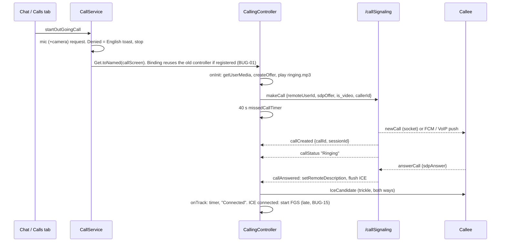
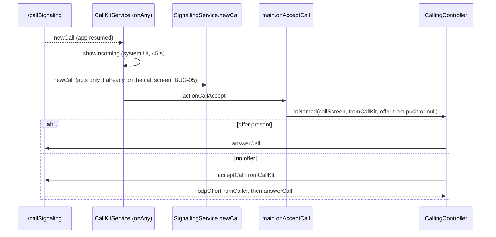
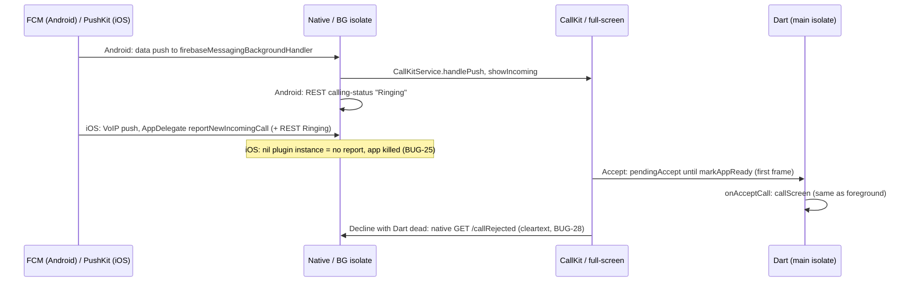
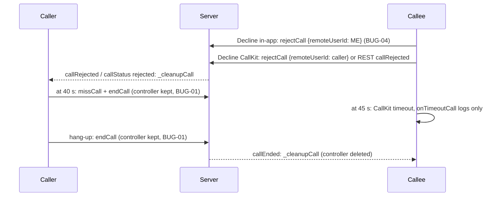
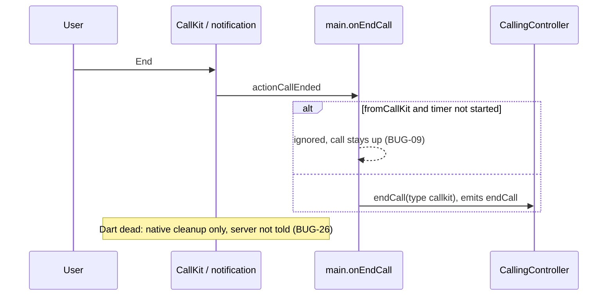
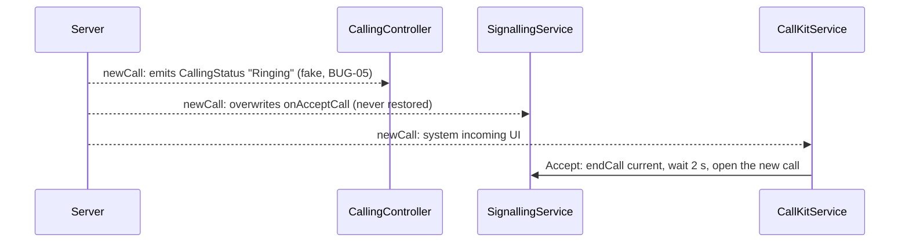
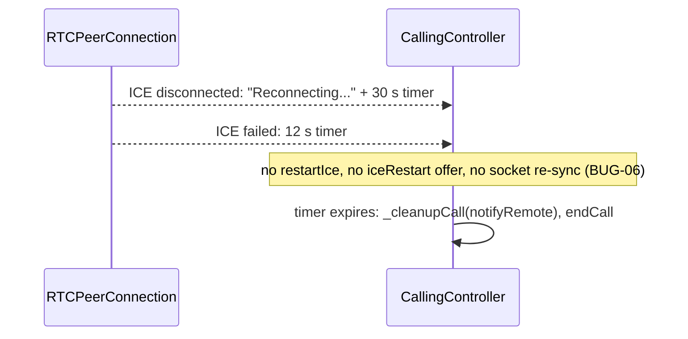
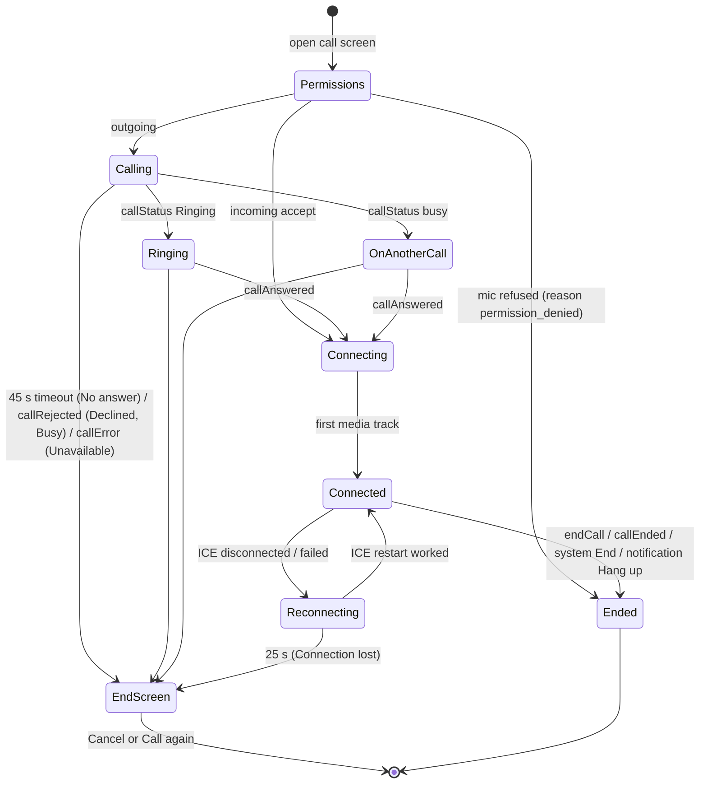

# Calling Module — Flutter Frontend Architecture & Implementation Guide

**Document Version:** `v1.4.0` · **Last updated:** 2026-11-18 · **Branch:** `46Solution`  
**Target Audience:** Flutter Frontend Developers & Backend Integrators  
**Covers:** 1-on-1 Audio/Video Calls (reliability, permissions, busy / call waiting, reconnect, CallKit, PiP), WebRTC PeerConnection, AWS SFU & Coturn STUN/TURN, Sockets & REST APIs, CallKit, Audio Routing, Proximity Sensor, In-App PIP Overlay, Screen Sharing, Recent Calls Cache & Multi-Delete  
**Status:** Phases 1–3 done in code (uncommitted), unit-tested; **phone checks and backend items pending** (§5.3, §8, `testing/calling/`)  

---

## 0. AWS Infrastructure & Server Confirmation

### 0.1 AWS Deployment Status (Verified Live)
* **Server Host:** `sfu.fgtracker.fgmanpower.co.in` (Resolves to AWS EC2 Mumbai `ap-south-1` IP `35.154.126.x`).
* **Active Services on AWS:**
  1. **Socket.io Signaling Server:** Node.js application hosting `/callSignaling`, `/screen-share`, `/groupCall`.
  2. **Coturn STUN/TURN Server:** port `3478` (UDP/TCP). TURN over TLS on `443` is **not live yet** (the app lists it since v1.4.0; backend item B-09 in §8).
  3. **LiveKit SFU Gateway:** `wss://sfu.fgtracker.fgmanpower.co.in` for multi-party group calls.
* **Environment Selection (`lib/app/Core/constant/urls.dart`):**
  - Controlled by `ConstRes.isProduction`.
  - Production uses static TURN credentials compiled into the app (not repeated here; see pentest SEC-CALL-03). Since v1.4.0 the app first asks the backend for short-lived credentials (`GET /api/calls/turn-credentials`, B-09) and falls back to the static list.

### 0.2 Understanding Data Processing Latency & Slowness
If video or calling appears sluggish or delayed during testing, the runtime logs reveal the exact technical causes:
1. **Network Bandwidth Estimation (BWE):** Mobile networks/emulators frequently drop into low BWE (e.g. `Current BWE 148000 ~ 190119 bps` ≈ 150-190 kbps). When BWE drops below video bitrate thresholds, Google WebRTC enters `bandwidth limited state` and stops active probing.
2. **Playout Delay Buffering:** When packet jitter occurs on bandwidth-limited connections, the WebRTC receive pipeline automatically adapts receiver playout delays (e.g. `Actual delay value set to 744 ms`), introducing ~0.75s of visible latency to prevent frame stuttering.
3. **High Resolution Target:** Default video stream requests `1280x720 @ 30fps` with `1.8 Mbps` target bitrate, and Screen Sharing requests `2.5 Mbps`. On constrained mobile connections, this forces WebRTC into aggressive downscaling and temporal frame drops.

---

## 1. Architecture & File Registry

| Layer | File Path | Core Responsibility |
|---|---|---|
| **Repositories** | `lib/app/Data/Repositories/call_repo.dart` | Communicates with `/api/history`, `/api/getCallDetail`, `/api/calling-status` |
| **Single Signaling** | `lib/app/Data/Services/Socket/Socket_SignallingService.dart` | Socket.io client for `/callSignaling` namespace |
| **Screen Share Signaling**| `lib/app/modules/mediaStream/Controller/calling_controller.dart` | Direct socket handlers for `/screen-share` namespace |
| **Group Signaling** | `lib/app/Data/Services/Socket/Socket_Group_Calling.dart` | Socket.io client for `/groupCall` namespace |
| **CallKit Service** | `lib/app/Data/Services/IncommingCallKit/callkit_service.dart`<br>`lib/app/Data/Services/IncommingCallKit/call_session.dart` | Integrates iOS CallKit & Android Telecom framework |
| **Audio Routing** | `lib/app/modules/mediaStream/Controller/call_audio_route_controller.dart` | Manages hardware output: Speaker, Earpiece, Bluetooth, Wired Headset |
| **Overlay Service** | `lib/app/modules/mediaStream/Services/in_app_call_overlay_service.dart` | Floating movable PiP bubble across the entire app |
| **1-on-1 Call Controller**| `lib/app/modules/mediaStream/Controller/calling_controller.dart` | WebRTC lifecycle, camera switch, proximity screen lock, timer |
| **Group Call Controller**| `lib/app/modules/mediaStream/Controller/group_calling_controller.dart` | Mesh / SFU peer connections, group video layout |
| **Screens & Views** | `lib/app/modules/call/Views/call_screen.dart`<br>`lib/app/modules/mediaStream/Views/calling_screen.dart`<br>`lib/app/modules/mediaStream/Views/AudioCall_screen.dart` | Visual UI presentation layers |

---

## 2. 1-on-1 Calling: Socket Events & REST APIs

### 2.1 Complete Socket Event Specification (`/callSignaling` & `/screen-share`)

#### Outgoing & Signaling Core
| Event Name | Direction | Payload Schema | Purpose & Flow |
|---|---|---|---|
| `makeCall` | Client ➔ Server | `{ remoteUserId, sdpOffer, is_video, callerId }` | Emitted by caller after creating SDP offer and local description. |
| `newCall` | Server ➔ Client | `{ callId, callerId, caller_name, caller_profile_image, isVideo, sdpOffer?, callData? }` (`callData` = JSON with `callId, callerId, callerName, callerProfileImage, sdpOfferCompressed, session_id`) | Pushed to receiver socket (or VoIP / FCM push). During a live call the app shows the waiting banner (§7.2). |
| `CallingStatus` → `callStatus` | Callee ➔ Server ➔ Caller | `{ callId, remoteUserId, callingStatus }` | `"Ringing"` when the callee device shows the call; `"busy"` when the callee is on another call (§7.2). `"Connected"` is not sent. |
| `answerCall` | Client ➔ Server | `{ callId, callerId, sdpAnswer }` | Emitted by receiver after generating SDP answer. |
| `callAnswered` | Server ➔ Client | `{ callId, sdpAnswer }` | Caller receives answer and sets remote description. |
| `IceCandidate` | Bidirectional | `{ remoteUserId, iceCandidate: { id, label, candidate } }` | ICE trickling for NAT candidate exchange. |
| `rejectCall` → `callRejected` | Callee ➔ Server ➔ Caller | `{ callId, remoteUserId: <callerId>, reason? }` (`busy` | `declined` | `permission_denied`) | Decline. Paths: in-app screen and CallKit (socket); REST `callRejected?callId=` when the socket is down; iOS / Android native REST when Dart is not running. |
| `endCall` → `callEnded` | Either side ➔ Server ➔ other side | `{ callId, to, remoteUserId, callerId, receiverId, sessionId, reason? }` (`connection_lost` | `permission_denied`) | Hang-up. Sent exactly once per call; events naming another call are ignored (BUG-CALL-37). |
| `missCall` (Caller ➔ Server) / `missedCall` (Server ➔ callee) | as shown | `{ callId, remoteUserId }` | Caller ring timeout **45 s** (`kCallRingTimeout`, same as the CallKit `duration`), then `endCall`. |
| `acceptCallFromCallKit` → `sdpOfferFromCaller` | Callee ➔ Server ➔ Callee | `{ callerId, sessionId, callId, receiverId }` → `{ callId, sdpOffer }` | Accept when the push had no SDP offer; the callee then answers with `answerCall`. |
| `rejoinCall` | Client ➔ Server | `{ callId, sessionId, remoteUserId }` | **New (v1.4.0, backend B-06):** after the signaling socket reconnects during a call. Ignored by today's server. |

#### Media State & Upgrades
| Event Name | Direction | Payload Schema | Purpose & Flow |
|---|---|---|---|
| `upgradeToVideo` | Either side ➔ Server ➔ other side | `{ callId, remoteUserId, callerId, sdpOffer? , iceRestart?, cameraState?, needKeyframe?, mediaState? }` | Renegotiation relay: video upgrade, **ICE restart** (`iceRestart: true`, §7.3), camera state, keyframe request, **media state** (`mediaState: {micMuted, cameraOn, videoPaused}`, §7.5). The server must forward unknown fields unchanged. |
| `upgradeToVideoAnswer` | Either side ➔ Server ➔ other side | `{ callId, remoteUserId, sdpAnswer }` | Answer to any `upgradeToVideo` offer (incl. ICE restart). |
| `cameraState` | Server ➔ Client | `{ cameraState: bool, userId }` | Syncs remote peer's camera muted/unmuted state. |

#### 1-on-1 Screen Sharing (`/screen-share` Namespace)
| Event Name | Direction | Payload Schema | Purpose & Flow |
|---|---|---|---|
| `start_screen_share` | Client ➔ Server | `{ callId, targetUserId }` | Initiates secondary WebRTC peer connection for screen capture. |
| `screen_share_offer` | Client ➔ Server | `{ callId, targetUserId, sdpOffer }` | Sends screen stream SDP offer (2.5 Mbps, 15 fps screencast). |
| `screen_share_answer` | Client ➔ Server | `{ callId, targetUserId, sdpAnswer }` | Remote peer answers screen sharing offer. |
| `screen_share_ice` | Bidirectional | `{ callId, targetUserId, candidate }` | ICE candidate exchange for screen sharing stream. |
| `stop_screen_share` | Bidirectional | `{ callId, targetUserId }` | Terminates screen stream and restores standard camera PiP. |

---

### 2.2 REST APIs for 1-on-1 Calling

#### 1. Recent Call History
* **Endpoint:** `GET /api/history`
* **Headers:** `Authorization: Bearer <token>`
* **Query Parameters:** `page=1&limit=20&filter=all|missed|incoming|outgoing`
* **Response:**
  ```json
  {
    "status": true,
    "message": "Call history fetched successfully",
    "data": {
      "today": [{ "id": "call_2", "callType": "private", "type": "video", "direction": "outgoing", "status": "completed", "duration": 120 }],
      "yesterday": [],
      "older": []
    }
  }
  ```

#### 2. Call Session Audit Details
* **Endpoint:** `GET /api/getCallDetail?callId=<callId>`
* **Headers:** `Authorization: Bearer <token>`
* **Response:** Returns caller/receiver profile, call duration, start time, termination reason, and participant records.

#### 3. Update Calling Status
* **Endpoint:** `POST /api/calling-status`
* **Headers:** `Authorization: Bearer <token>`
* **Body:** `{ "callId": 2, "callingStatus": "missed" | "rejected" | "ended", "duration": 45 }`

#### 4. LiveKit SFU Token Generation (Group Calls)
* **Endpoint:** `POST /api/calls/livekit-token`
* **Headers:** `Authorization: Bearer <token>`
* **Body:** `{ "roomName": "call_room_2", "participantName": "Vikas" }`
* **Response:** `{ "status": true, "token": "jwt_livekit_token", "wsUrl": "wss://sfu.fgtracker.fgmanpower.co.in" }`

---

## 3. Hardware Controls & Feature Implementation

### 3.1 Mic On / Off (Mute Toggle)
* **Function:** `CallingController.toggleMic()`
* **Mechanism:**
  ```dart
  isAudioOn = !isAudioOn;
  localStream?.getAudioTracks().forEach((t) => t.enabled = isAudioOn);
  update();
  ```
* **UI Rebuild:** Bound through `GetBuilder<CallingController>` in `CallingScreen` so the button icon instantly switches between `Icons.mic_rounded` and `Icons.mic_off_rounded`.

### 3.2 Speaker / Earpiece Audio Switching
* **Function:** `CallingController.toggleSpeaker(BuildContext context)`
* **Intelligent Fast Switching:**
  - **Single Tap Toggle:** When no external audio device (Bluetooth headset or wired headphones) is connected, tapping the audio button instantly toggles between **Speaker** (`CallAudioRoute.speaker`) and **Earpiece** (`CallAudioRoute.earpiece`) without opening any modal dialog.
  - **Device Picker Sheet:** If Bluetooth or a wired headset is plugged in, `showAudioRoutePicker(context)` opens the native route picker sheet.
  - **Video Call Parity:** `CallAudioRouteController.availableRoutes` allows `earpiece` in both audio and video calls, enabling private listening during video calls.

### 3.3 Camera Switch (Front / Back)
* **Dual Trigger Architecture:**
  1. **Top Bar Button:** Located on the top right of `CallingScreen._topBar` whenever video is active.
  2. **PiP Badge Button:** Located on the floating camera preview tile.
* **Mechanism:**
  ```dart
  final MediaStreamTrack track = tracks.first;
  await Helper.switchCamera(track);
  isFrontCamera = !isFrontCamera;
  update();
  ```
  Switching `tracks.first` guarantees that secondary screen sharing tracks are not mistakenly flipped.

### 3.4 In-App Floating Overlay (Minimize Call)
* **Service:** `InAppCallOverlayService`
* **Bug Resolved (`No Overlay widget found`):**
  - Previously, `Overlay.of(Get.overlayContext!)` threw when called on an unattached theater context.
  - Resolved using safe navigation key lookup:
    ```dart
    final OverlayState? overlayState = Get.key.currentState?.overlay ??
        (Get.overlayContext != null ? Overlay.maybeOf(Get.overlayContext!) : null);
    ```
  - When minimized, renders a draggable floating bubble showing caller video or avatar, call duration, mute status, and expand/end controls.

---

## 4. Change Log

| Version | Date | Change |
|---|---|---|
| v1.4.0 | 2026-11-18 | Phase 3 (uncommitted): §7 added (busy / call waiting, ICE restart + rejoin, TURN service + TLS 443 fallback, quality badge, other side's state, end screen + tones, missed-call Call back, iOS CallKit outgoing + mute/hold + VoIP token upload, Android PiP); §8 backend handover (B-01 … B-16). Out-of-date parts fixed (C19): header status, §0.1 (TURN 443 not live; credential name removed), event tables (directions, fields, reasons, `acceptCallFromCallKit`, `rejoinCall`). Late end events of another call are ignored (BUG-CALL-37/38). |
| v1.3.3 | 2026-11-18 | Phase 2 (permissions), uncommitted: §6 added. One permission policy for every call entry point; explainer / Settings / voice-instead sheets; accept without mic ends cleanly with `reason: permission_denied`; video accept without camera joins as voice with "Camera off · Allow"; Bluetooth permission on Android 12+; Calls-tab banner "Incoming calls may not ring"; one-time mic primer; no ghost call after the app is killed. 12 new strings in all 20 locales. |
| v1.3.2 | 2026-11-18 | Phase 1 (reliability), uncommitted: fresh controller per call, current socket + wait-for-connect, own socket handlers only, reject to the caller, system End always ends, stale ringing check, one ring timeout (45 s caller = CallKit), ongoing-call service from call start (mic + camera, Hang up), no location prompt during a call, "You're already on a call". New: `Services/call_platform.dart`, `call_socket_handlers.dart`, `call_entry.dart`, `call_foreground_service.dart`, `IncommingCallKit/call_kit_handlers.dart`. Details: `testing/calling/bug_tracker.md`. |
| v1.3.1 | 2026-11-18 | §5 added: Part 0 audit of 1:1 calling (real flows, F1–F16 gap table, backend questions, phased plan). Findings with proof are in [`docs/testing/calling/bug_tracker.md`](testing/calling/bug_tracker.md). No app code changed. Note: §0.1 "TLS port 443" is **not** used by the production app (see BUG-CALL-07); full corrections come with v1.4.0. |
| v1.3.0 | 2026-11-18 | Added AWS Server Confirmation (`sfu.fgtracker.fgmanpower.co.in:3478`). Documented all 1-on-1 socket events & REST APIs in full detail. Fixed overlay crash via `Overlay.maybeOf`. Re-enabled direct speaker-to-earpiece toggle. Added top-bar camera switch trigger and wrapped `CallingScreen` in `GetBuilder` for instant reactive UI updates. |
| v1.2.0 | 2026-11-17 | Recent calls cache (guide 07): today's first page shown at once, replaced by the API, retry bar, resume refresh, deletes saved. |
| v1.1.0 | 2026-11-07 | Recent Calls multi-select delete: header 3-dot menu removed; long-press a row to select; optimistic bulk delete. |
| v1.0.0 | — | Initial release of calling architecture. |

---

## 5. Audit 2026-11-18 (Part 0) — 1:1 calls, Android + iOS

Status: **audit only, no code changed.** Every claim below has file:line proof in [`testing/calling/bug_tracker.md`](testing/calling/bug_tracker.md) (BUG-CALL-01 … 30). The flows describe the code **as it is today** at `3e16f524`, bugs included.

### 5.1 Real flows

**Outgoing (caller)**



**Incoming, app in foreground (socket)**



**Incoming, background / killed**



**Accept / decline / missed / end**



**End from the system call UI**



**Second call during a call**



**Network loss**



### 5.2 Gap table (confirmed)

| # | Area | Status | Proof / note |
|---|---|---|---|
| F1 | Rings when killed / locked | **Partial** | Android FCM full-screen works. iOS: token updates not uploaded (BUG-11), nil-plugin path (BUG-25), `aps-environment=development` for every config |
| F2 | Caller states + end screen | **Partial** | Calling / Ringing / Connecting from `callStatus`; no end screen; raw English status strings (BUG-17) |
| F3 | Busy / call waiting | **Broken** | BUG-05 (three conflicting paths, fake Ringing) |
| F4 | Decline reaches the caller | **Broken** in-app / Have via CallKit | BUG-04 |
| F5 | One missed timeout + call back | **Partial** | 40 vs 45 s (BUG-08); `isShowCallback: false` |
| F6 | In-call controls | **Have** | — |
| F7 | Other side's state | **Partial** | Camera on/off only; no muted / video paused |
| F8 | Network recovery / quality | **Missing** | BUG-06, BUG-07 |
| F9 | Background / lock | **Partial** | FGS late, no camera type (BUG-15); in-app overlay only |
| F10 | OS integration | **Partial** | BUG-12, BUG-23 (Recents), BUG-26 |
| F11 | Permissions in context | **Broken** | BUG-13, BUG-30 |
| F12 | Proximity / audio route | **Have** | Bluetooth runtime permission missing (BUG-13) |
| F13 | Screen share | **Have** | Uses the same static TURN (BUG-07) |
| F14 | Live call history | **Partial** | `silentRefresh` only after an outgoing call returns (`call_service.dart:59-61`) |
| F15 | Security | **Partial** | BUG-07, BUG-20, BUG-28; VoIP token logged in full |
| F16 | Every call starts clean | **Broken** | BUG-01, -02, -03, -21, -22 |
| F17 (new) | Right screen after a minimized call ends | **Broken** | BUG-22 |
| F18 (new) | No unrelated prompts during a call | **Broken** | Location init in `onInit` (BUG-18) |

### 5.3 Not done in Part 0 (needs people or hardware)

- **Device reproduction (step 5) was not run.** No phones are available to me. The six scenarios (3 calls in a row, logout → login → call, in-app reject, busy callee, Wi-Fi → 4G, 3478 blocked) map to M-12, M-13, M-03, M-05, M-06, M-07. A tester can run them on the current build with the `[CK]` / `[CAM]` / `[Call]` logs, or they run with the Phase 1 build.
- **Backend check (step 6) was not done.** I have no backend access. Questions for the backend developer:
  1. Does `/callSignaling` verify a token, or does it trust `query.callerId`? (BUG-20)
  2. Which events exist today for busy, ringing, ICE restart and re-join? Is there a `busy` / `callWaiting` result?
  3. Who owns the ring timeout, and what is the value? Does the server send `missedCall` to both sides?
  4. Is `turns:` on 443 (TLS) live on the production TURN host? Is there a short-lived TURN credential endpoint?
  5. Is there an endpoint to update the iOS VoIP token after login?
  6. Does `rejectCall` route by `remoteUserId` or by `callId`? (This decides whether BUG-04 is visible today.)
  7. Which APNs environment do VoIP pushes use for release builds?

### 5.4 Plan

Estimates are dev-days for one developer, unit tests included. "BE" = needs the backend.

| Phase | Item | Est. | Risk | BE |
|---|---|---|---|---|
| **1 Reliability** | Test seams: `CallMediaEngine`, `CallKitGateway`, socket getter, reuse the chat fake socket server | 1.5 | Medium (large controller) | — |
| | BUG-01/21/22: fresh controller per call (delete on every end path, args read in `onInit`, never force-delete a live call, overlay End without a pop) | 1.5 | **High** (minimized call + overlay) | — |
| | BUG-02: socket getter + connect-and-wait before `makeCall` | 0.5 | Low | — |
| | BUG-03: handler references, `off(event, handler)` only | 1 | Medium (screen share, video upgrade) | — |
| | BUG-04 + BUG-14: one accept path, one argument shape | 1 | Medium | — |
| | BUG-09, BUG-10 + BUG-24 (status check with timeout; "unknown" is not "ended") | 1 | Low | — |
| | BUG-15: FGS at call start, `microphone` (+ `camera` for video), Hang-up action, localized texts | 1 | **High** (Android 14 FGS rules; walkie and screen share use the same service) | — |
| | BUG-08 client constant, BUG-18 hygiene (location init: ask first), BUG-27 manifest cleanup | 1 | Low | — |
| **2 Permissions** | `CallPermissionPolicy` (pure Dart) + sheet + ARB strings, wired into every entry point incl. BUG-30; voice fallback; Bluetooth; re-check on resume | 3 | Medium (no new prompts in walkie / attendance / gate) | — |
| **3 Parity** | Busy + call waiting (BUG-05) | 2 | Medium | **Yes** |
| | ICE restart + socket re-sync (BUG-06) | 2.5 | **High** | Yes (relay / rejoin) |
| | TURN 443 + short-lived credentials (BUG-07) | 1 | Low (client) | **Yes** |
| | Quality badge + bitrate adapt | 1.5 | Medium | — |
| | `mediaState` (muted / paused / camera) | 1 | Low | Yes |
| | End screen, tones, missed-call Call back / Message | 2 | Low | Partly (reasons) |
| | iOS CallKit: `startCall`, mute / hold / audio session, one audio path, BUG-23, BUG-29 | 3 | **High** (needs iPhones) | — |
| | VoIP token upload (BUG-11) | 0.5 | Low | **Yes** (endpoint) |
| | System End with Dart dead (BUG-26), HTTPS native reject (BUG-28), BUG-25 | 1 | Medium | Maybe |
| | PiP on Android (+ iOS feasibility report) | 2 | Medium (package?) | — |
| **4 Contract** | Backend contract section in this guide | 0.5 | — | — |
| **Tests / E2E / docs** | `test/call_qa/`, signaling E2E + Node bot, manual matrix, testing docs, guide v1.4.0 | 4 | Medium | Staging needed for E2E |

Total ≈ 37 dev-days, plus phone time for the M-xx matrix.

### 5.5 Decisions needed

1. **Protected file (BUG-11).** `OtpController.registerPushTokens` returns before reading the FCM token when the iOS VoIP token is `null`. *This change affects the completed and verified Login / Location Sharing & Private Mode synchronization module. Do you want to make changes to this completed module?* If not, Phase 3 uploads the VoIP token through a separate endpoint and leaves this as is.
2. **Location init during calls (BUG-18).** Remove `GroupTrackingController.instance.initializeLocation()` from `CallingController.onInit`? It is not a protected method, but it is tracking start-up.
3. **Backup files** in `test/`: move them, or delete them?
4. **Packages** Phase 3 will likely need: a connectivity plugin (network change) and possibly a PiP plugin.

**Answers (2026-11-18):**
1. Login / OTP must not break → `OtpController` stays untouched. The iOS VoIP token goes through a separate upload in Phase 3 (needs a backend endpoint).
2. `initializeLocation()` at call start was added with group calls (commit `9a6c524a`) to keep location tracking running while the phone is locked during a call. It is **kept**, but now runs only when location permission and GPS are already on, so no permission or "turn on GPS" dialog can appear over a call (`CallPlatform.keepTrackingAlive`).
3. No files deleted. The backup files stay in `test/`; new tests use new, versioned names (`test/call_qa/*_v1_test.dart`).
4. Plan approved; Phase 1 done (see change log v1.3.2).

---

## 6. Permissions on the calling screen (Phase 2, v1.3.3)

**Files.**
- `mediaStream/Services/call_permissions.dart`: `CallPermissionPolicy` (pure decision table), `CallPermissionFlow` (runs the steps), `CallPermissionBackend` (device).
- `mediaStream/Widget/call_permission_sheet.dart`: the sheet.
- `call/widget/call_ring_readiness_banner.dart`: the Calls-tab banner.

**Statuses.** `granted`; `canAsk` (the system dialog can still be shown); `blocked` (permanently denied or restricted, or iOS after one "Don't Allow": only Settings can change it).

**Where it runs (every entry point).**

| Entry | Code |
|---|---|
| Outgoing (chat, Calls tab, recents, contacts, profile, tracking map, dialogs) | `CallService.prepareOutgoingCall` → `beforeCall(incoming: false)`, **before** the call screen opens, so nothing reaches the other user first |
| Accept (in-app screen or CallKit / full-screen) | `CallingController._ensureCallPermissions` → `beforeCall(incoming: true)`, on the call screen, before any media |
| Camera on during a call, "Camera off · Allow" chip | `CallingController._cameraAllowed` → `cameraDuringCall` |
| Audio route sheet (Bluetooth) | `showAudioRoutePicker` → `bluetoothForRoutes` |
| Calls tab | `CallRingReadinessBanner`: ring readiness + one-time mic primer |
| Overlay expand | Same live call, media already open: no check |

| ID | Case | Behaviour |
|---|---|---|
| P-01 | Outgoing, mic never asked | Sheet "Allow microphone" → system dialog → call starts only after grant. "Not now" = no dialog, no call |
| P-02 | Outgoing, mic denied | Same sheet again with Allow; Cancel = no call |
| P-03 | Mic blocked | Sheet with Open Settings; on return the mic is re-checked and the call continues by itself |
| P-04 | Outgoing video, camera refused or blocked | Sheet: Start voice call instead / Open Settings / Cancel |
| P-05 | Accept, mic not granted | System dialog on the call screen. Refused or blocked + Cancel: the call ends through the normal end path, `endCall` carries `reason: "permission_denied"`, toast "Microphone access is needed to answer calls" |
| P-06 | Accept video, camera refused | Join as voice (own camera off), remote video still shown, chip "Camera off · Allow" |
| P-07 | Camera on during a call, not granted | Dialog, or a sheet with Open Settings; the call always continues |
| P-08 | Android 12+ `BLUETOOTH_CONNECT` | Asked when the route sheet opens and a Bluetooth device is present; refused = Bluetooth hidden (`CallAudioRouteController.bluetoothPermitted`) |
| P-09 | Notifications / Android 14 full-screen intent missing | Calls tab banner "Incoming calls may not ring · Allow"; never blocks calling |
| P-10 | iOS answer from lock screen, mic never asked | One-time sheet on the first visit to Calls (`call_mic_primer_shown_v1`); at accept the dialog appears after unlock, with no crash or ghost call |
| P-11 | Permission revoked in Settings during a call (Android kills the app) | On relaunch the accepted CallKit call is checked with the server (`getCallStatus`); ended → dismissed, not reopened. Unknown (offline) → old behaviour |
| P-12 | Back from Settings | `CallPermissionBackend.waitForResume` (AppLifecycleListener), then the pending step continues |

**Strings.** The 12 `call_perm*` keys exist in all 20 ARB files. The sheet also reuses `common_allow`, `common_notNow`, `common_cancel` and `permission_openSettings`.

**Backend note (Part 4).** `endCall` may now carry an optional `reason` field. Old clients and servers ignore unknown fields.

---

## 7. WhatsApp / IMO parity (Phase 3, v1.4.0)

All of this is in code (uncommitted) and unit-tested (`test/call_qa/call_parity_v1_test.dart`, CT-05 … CT-14, UI-01). Items marked **BE** need the backend to work fully (§8); until then they degrade safely with today's server.

### 7.1 Call life cycle (one controller per call)



Every end goes through `_finishCall` (one path): timers off, `endCall` sent once, CallKit dismissed, foreground service stopped (only if the call started it), wakelock and proximity off, end tone, controller deleted, Recent calls refreshed after 2 s.

### 7.2 Busy and call waiting (BUG-CALL-05)
- **Callee already in a call:** a `newCall` (socket, or an FCM push while the app is open) opens a **waiting banner** on the call screen: "X is calling…" with **Decline** / **End & accept**. The system incoming UI is not shown on top of the call. The app sends `CallingStatus {callingStatus: "busy"}` to that caller; before, it sent a fake `"Ringing"`.
- **Decline** sends `rejectCall {reason: "busy"}`. **End & accept** ends the current call (`endCall`), then joins the new one with the normal accept path.
- **Accept from the system UI while in a call** (iOS CallKit "End & Accept", or a second Android full-screen call): the current call ends first. Before, the accept was ignored.
- **Caller:** `callStatus: busy` shows "On another call" and keeps ringing (the callee may still accept). `callRejected {reason: busy}` shows the end screen "On another call". **BE (B-04):** relay `busy` to the caller and keep `reason` on `callRejected`.
- Removed: the old `SignallingService` `newCall` handler that replaced the global CallKit accept handler and auto-switched calls after 2 s.

### 7.3 Network change and reconnect (BUG-CALL-06)
- `CallLinkMonitor`: on ICE `disconnected` / `failed` the screen shows "Reconnecting…". The original caller sends an **ICE restart** after 2 s (`failed`: at once), the callee after 6 s (no offer glare), then retries every 6 s. Media back = "Connected", and the timer keeps running. Still down after **25 s**: the call ends with `reason: connection_lost` and the end screen "Connection lost".
- The ICE-restart offer travels over the existing `upgradeToVideo` / `upgradeToVideoAnswer` relay with `iceRestart: true`, so it works with today's server. The receiver skips the video-upgrade side effects (no camera use on a voice call).
- Signaling socket reconnect during a call: the app sends `rejoinCall {callId, sessionId, remoteUserId}` (**BE B-06**) and restarts ICE if the media link is down. Audio keeps running while video recovers.
- No new package: ICE states detect the network change; no connectivity plugin.

### 7.4 TURN (BUG-CALL-07)
- `TurnCredentialService`: short-lived credentials from `GET /api/calls/turn-credentials` (**BE B-09**), cached until 1 minute before the TTL. On 404, error or a 3 s timeout it falls back to the static list, which now also contains `turns:sfu.fgtracker.fgmanpower.co.in:443?transport=tcp`. That entry only helps once a TLS TURN listener exists (B-09); until then it produces no candidates and blocks nothing. The screen-share peer uses the same service.
- The static credentials stay as a fallback until the endpoint is live; then remove them and rotate them on the server.

### 7.5 Quality and the other side's state (BUG-CALL-17)
- Every 3 s while connected, `getStats` gives RTT, audio packet loss and jitter (`CallStatsReader`). "Poor connection" shows after 2 poor samples (RTT > 400 ms, loss > 8 % or jitter > 60 ms) and hides after 2 good ones. With video on, the sender drops to half resolution and 400 kbit/s, and is restored when the link recovers. After 4 poor samples in a row with the camera on, the app shows the tip "Turn off your camera for clearer audio" once per call.
- Pills on the call screen: "X muted", "Video paused", "Poor connection", "On hold".
- Media state is sent as `upgradeToVideo {mediaState: {micMuted, cameraOn, videoPaused}}`: on mute, on app background (video paused, unless in PiP) and on resume. It works with today's relay. A dedicated `mediaState` event is also listened to (**BE B-08**, optional).

### 7.6 End screen and sounds
- After No answer (45 s), Declined, On another call, Unavailable (`callError`) or Connection lost, the call screen is replaced by `CallEndedScreen`: name, reason, **Call again** / **Cancel**. A user cancel before an answer shows no end screen.
- Tones (generated WAV, `assets/music/call_end_tone.wav`, `call_busy_tone.wav`): busy tone for "On another call", end tone otherwise; only when the call was announced to the other side.
- The missed-call notification now has **Call back**, which starts a call to the caller. A "Message" action is not supported by `flutter_callkit_incoming` 3.1.6 (only call back).

### 7.7 iOS CallKit (BUG-CALL-12, -11)
- **Outgoing calls are reported to CallKit** (`FlutterCallkitIncoming.startCall`, UUID per call): system call UI / Recents, end and mute from the lock screen and headset, hold by a cellular call. Kill switch: `kReportOutgoingCallsToCallKit` in `call_platform.dart`.
- **Same audio path for both directions.** Before `startCall`, Dart calls `prepareCallKitAudio` on the `com.fgtracker.audio_route` channel (AppDelegate). That sets WebRTC to manual audio, and CallKit's `didActivateAudioSession` enables it. Safety net: if CallKit has not activated the session after 2 s, audio is enabled anyway, so a call is never silent.
- **Mute / hold from CallKit** → `setMutedFromSystem` / `setOnHoldFromSystem` (mic, video and UI follow; there is no echo back to CallKit). The in-app mute button calls `muteCall` so the lock screen stays in sync. `supportsHolding: true` for incoming calls too, so a cellular call offers "Hold & Accept".
- **VoIP token:** every PushKit token change is uploaded via `POST /api/update-voip-token` (**BE B-10**), once per new token and retried on the next start after a failure. The token is never logged (only its length). `OtpController` is unchanged.
- **Not done (needs a decision or a device):**
  - iOS video PiP needs the `com.apple.developer.avfoundation.multitasking-camera-access` entitlement (request it from Apple) and an `AVPictureInPictureController` video-call view.
  - The iOS changes are not compiled or run here (no Mac in this session).

### 7.8 Android setup
- **Foreground service** (`flutter_foreground_task`): started at call start with `microphone`, plus `camera` when granted. It shows the ongoing-call notification with **Hang up**. The manifest declares `microphone|camera|phoneCall|mediaProjection` and `FOREGROUND_SERVICE_CAMERA`.
- **Full-screen incoming calls (Android 14):** checked on the Calls tab (P-09 banner).
- **Picture-in-picture (BUG-CALL-16):** `MainActivity` has `supportsPictureInPicture`, channel `com.fgtracker/pip`. Auto-PiP is on only for a connected video call whose screen is open (not minimized, not screen sharing): Android 12+ uses `setAutoEnterEnabled`, Android 8–11 uses `onUserLeaveHint`. In PiP the screen shows only the video. No plugin.

### 7.9 Files added in Phase 3
`Services/call_connection_monitor.dart`, `call_quality.dart`, `turn_credentials.dart`, `call_pip.dart`, `call_entry.dart` (waiting call, end outcome, media state), `Views/call_ended_screen.dart`, `IncommingCallKit/voip_token_uploader.dart`, `MainActivity.java` (PiP), `AppDelegate.swift` (`prepareCallKitAudio`), 2 tone assets, 14 new strings × 20 locales.

---

## 8. Backend handover — what the backend team must provide

**For:** the backend developer of the Node.js signaling server (`/callSignaling`), the REST API and coturn / push.
**Why:** the app (v1.4.0, branch `46Solution`) now behaves like WhatsApp / IMO for 1:1 calls. Some parts only work fully when the server does its part. Every client change is backward compatible: old app versions keep working with the new server, and the new app works with today's server, with the reduced behaviour noted below.
**Status values:** **Exists** = already works. **Partly** = exists but needs a change. **Missing** = new.

### 8.1 Summary

| ID | Item | Priority | Status | What the app does until then |
|---|---|---|---|---|
| B-01 | Authenticate the `/callSignaling` socket with the user token | **Critical** (security) | Missing | Connects with `query.callerId` only |
| B-02 | Check that the sender of every call event belongs to that `callId` | **Critical** (security) | Unknown | — |
| B-03 | One server-owned ring timeout (45 s), `missedCall` to both sides, refuse late accepts | High | Partly | Caller ends at 45 s by itself |
| B-04 | Busy: relay `callingStatus: "busy"` to the caller; keep `reason` on `callRejected` | High | Partly | Caller may see Declined instead of On another call |
| B-05 | Keep and validate `reason` on `rejectCall` / `endCall`; store it in call history | Medium | Missing | Reason is ignored |
| B-06 | `rejoinCall` after a socket reconnect; grace period before ending a call on disconnect | High | Missing | ICE restart still recovers media; server may end the call meanwhile |
| B-07 | Relay `upgradeToVideo` / `upgradeToVideoAnswer` with **all fields unchanged** | High | Exists (verify) | ICE restart and media state ride on it |
| B-08 | Optional dedicated `mediaState` relay | Low | Missing | Uses B-07 |
| B-09 | Short-lived TURN credentials endpoint + TURN over TLS 443 | High (reach + security) | Missing | Static credentials, no 443 |
| B-10 | VoIP token update endpoint (iOS) | High (iOS killed-app ringing) | Missing | Token only sent at login |
| B-11 | VoIP / FCM push payload keys (confirm) | Medium | Exists (confirm) | — |
| B-12 | `GET /api/getCallDetail` status values (document) | Medium | Exists (document) | Unknown status = keep ringing |
| B-13 | Native decline API over HTTPS on the production host | High (security) | Partly | App-side change too (see 8.2) |
| B-14 | Accept `remoteUserId` as string or number everywhere | Low | Unknown | Mixed today |
| B-15 | Always include `callId` and `sessionId` in `callEnded` / `callRejected` / `missedCall` | Medium | Partly | App ignores events for other calls when ids are present |
| B-16 | APNs environment for VoIP pushes per build | Medium | Unknown | `aps-environment=development` in the app today |

### 8.2 Details

**B-01 Socket authentication (Critical).**
Today the app connects to `/callSignaling` with `query: {callerId}` only. If the server trusts that id, anyone who knows a user id can connect as that user, receive their calls and SDP, and end or reject their calls.
*Needed:* verify the same JWT the REST API uses during the handshake (`auth.token` or `query.token`) and take the user id from the token, not from `callerId`. Reject the connection when it is missing or invalid.
*App side:* one line in `Socket_SignallingService.init` will add the token once the server accepts it (send both during a transition).
*Test:* pentest S-CALL cases in `docs/testing/calling/pentesting/pentest_report.md`.

**B-02 Sender checks (Critical).**
For `endCall`, `rejectCall`, `missCall`, `answerCall`, `acceptCallFromCallKit`, `IceCandidate`, `upgradeToVideo`, `upgradeToVideoAnswer`, `CallingStatus` and `rejoinCall`: the sender (from B-01) must be the caller or the callee of `callId`, and the target `remoteUserId` must be the other party of that call. Drop anything else.

**B-03 One ring timeout.**
- The server starts a **45 s** timer at `makeCall` (the app uses 45 s too: the caller timer and the callee's CallKit / full-screen `duration`).
- On expiry, mark the call `missed` and send `missedCall {callId, sessionId}` to **both** sides plus the end push (FCM `screen_name: missedCall` / VoIP `signal_type: endCall`).
- An `answerCall` or `acceptCallFromCallKit` after that must get `callError {callId, code: "call_expired", message}` and must not connect.
- Today the caller app sends `missCall` + `endCall` at 45 s; keep accepting that.

**B-04 Busy and call waiting.**
When the callee is already in a call, still deliver `newCall` (the app shows a waiting banner). The callee app then emits:
```json
CallingStatus { "callId": "900", "remoteUserId": 303, "callingStatus": "busy" }
```
Relay it to the caller as `callStatus { callId, status: "busy" }`; the caller shows "On another call" and keeps ringing. If the callee declines the waiting call, the app emits `rejectCall { callId, remoteUserId: <callerId>, reason: "busy" }`. Relay `callRejected` to the caller **with `reason`**; the caller shows the end screen "On another call" and plays the busy tone.
*Optional:* if the callee has no app connection but is known to be in a call, answer the caller directly with `callStatus busy`.

**B-05 Reasons.**
Allowed values:
- `rejectCall.reason`: `declined`, `busy`, `permission_denied`.
- `endCall.reason`: `connection_lost`, `permission_denied`.

Accept only these, ignore anything else, forward the value on `callRejected` / `callEnded`, and store it in the call record. History status: rejected with `busy` → "busy"; ended with `connection_lost` → "failed"; rejected with `permission_denied` → "missed".

**B-06 Re-join after a signaling reconnect.**
When a socket drops during a connected call (Wi-Fi ↔ 4G), do **not** end the call at once: keep it for a **30 s grace** period. When the same user reconnects, the app emits:
```json
rejoinCall { "callId": 501, "sessionId": "s501", "remoteUserId": "202" }
```
Bind the new socket to the call and answer with the current state:
- `callStatus { callId, status: "connected" }` if the call is still on;
- `callEnded { callId, sessionId }` if it ended meanwhile.

Relayed events for that user during the outage may be dropped; the app restarts ICE itself.

**B-07 Renegotiation relay (verify).**
`upgradeToVideo` and `upgradeToVideoAnswer` must be forwarded to `remoteUserId` **with every field unchanged**, including new ones:
- `iceRestart: true` with `sdpOffer` (network-change recovery);
- `mediaState: {micMuted, cameraOn, videoPaused}` without `sdpOffer`;
- the existing `cameraState` and `needKeyframe`.

If the server whitelists fields today, add `iceRestart` and `mediaState`.

**B-08 `mediaState` event (optional).**
`mediaState { callId, remoteUserId, mediaState: {micMuted, cameraOn, videoPaused} }` → relay as `mediaState` to `remoteUserId`. The app already listens for it. Until then B-07 carries it.

**B-09 TURN.**
1. **Endpoint** `GET /api/calls/turn-credentials` (Bearer token) → `200`:
   ```json
   { "urls": ["turn:<host>:3478?transport=udp", "turn:<host>:3478?transport=tcp", "turns:<host>:443?transport=tcp"],
     "username": "<expiry-unix>:<userId>", "credential": "<base64 HMAC-SHA1>", "ttl": 3600 }
   ```
   (coturn `use-auth-secret` / `static-auth-secret`; TTL 1–24 h). The app also accepts the same object inside `data`.
2. **TLS on 443:** a coturn TLS listener on 443 with a real certificate. LiveKit already uses 443 on `sfu.fgtracker.fgmanpower.co.in`, so use a separate hostname or IP (for example `turn.<domain>`), or LiveKit's built-in TURN/TLS. Tell the app team the final URL; today the app tries `turns:sfu.fgtracker.fgmanpower.co.in:443`.
3. **Rotate** the current static TURN credential after the app release that uses the endpoint: it is compiled into every installed app (pentest SEC-CALL-03). Screen share, group calls and walkie-talkie use the same credential, so check them before rotating.

**B-10 iOS VoIP token update.**
`POST /api/update-voip-token` (Bearer) with body:
```json
{ "voipToken": "<hex>", "platform": "ios" }
```
→ `200 {status: true}`. Store it for the logged-in user and device, replacing the previous token; remove it on logout or force-logout. The app calls it on every PushKit token change and at start (deduplicated). Login (`Voip_Device` in the OTP verify call) stays as it is.

**B-11 Push payloads (confirm).**
- **iOS VoIP push** (incoming): `id` or `sessionId`, `callId`, `callerId`, `callerName` (or `nameCaller`), `avatar`, `isVideo`, optional `callerPhone`.
- **End push:** `signal_type: "endCall"` with the same ids.
- **Android FCM data:** `screen_name: "incomingCall"` with `callData` = JSON `{callId, callerId, callerName, callerProfileImage, isVideo, session_id, sdpOfferCompressed?}`; end pushes use `screen_name: "callEnded" | "missedCall"`.

Every push must be **data-only, high priority** (Android) and VoIP type (iOS), or the call will not ring when the app is killed.

**B-12 `GET /api/getCallDetail?callId=`.**
The app reads `callDetail.status` on start, resume and relaunch to clear stale ringing calls. Treated as over: `missed`, `rejected`, `declined`, `ended`, `cancelled`, `canceled`, `disconnected`. Everything else, and any error, means "not over". Please document the full list and keep it fast (< 500 ms); it runs with a 4 s timeout.

**B-13 Native decline API.**
The Android `CallDeclineReceiver.kt` and iOS `AppDelegate.swift` call `GET http://fgtracker.in:3000/api/callRejected?callId=` with the Bearer token:
- it is cleartext HTTP;
- it is a different host from the production API the Dart app uses.

Confirm the correct HTTPS URL. The app team will change both native files; the endpoint must also accept `reason=declined`.

**B-14 Id types.**
`remoteUserId` is sent as a string by most events and as a number by `CallingStatus`. Accept both everywhere.

**B-15 Ids on end events.**
`callEnded`, `callRejected` and `missedCall` must always carry `callId` **and** `sessionId`. Since v1.4.0 the app ignores an end event that names a different call, which protects against late events from an earlier call. Without ids it falls back to the old behaviour: it ends whatever call is open.

**B-16 APNs environment.**
The app entitlement says `aps-environment=development` for every build. Confirm which APNs gateway the server uses for TestFlight and App Store builds; the app team will set `production` for Release.

### 8.3 Open questions for the backend team (from §5.3)
1. Does `/callSignaling` verify a token today (B-01)?
2. Does `rejectCall` route by `remoteUserId` or by `callId`?
3. Does the server have its own ring timeout, and what value?
4. Is any field whitelisting applied to `upgradeToVideo` (B-07)?
5. Which hostname and port will TLS TURN use (B-09)?

### 8.4 How to test (with a staging server)
- **Signaling E2E:** `scripts/call_qa/call_bot.js` plays the other user (answer, reject, busy, timeout, drop and reconnect, call the app); `integration_test/call_signaling_e2e_test.dart` drives the app side. See `scripts/call_qa/README.md`. Needs a staging URL and two test accounts.
- **Security cases:** S-CALL-01 … in `docs/testing/calling/pentesting/pentest_report.md` (impersonation, spoofed `endCall` / `rejectCall`, reason allowlist).
- **Phones:** `docs/testing/calling/manual_testing/manual_checklist.md`.
