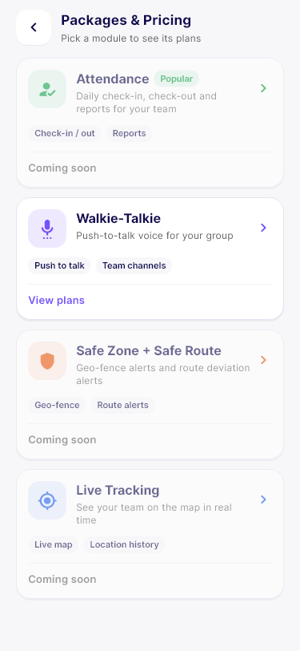
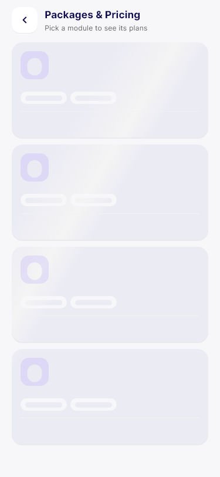
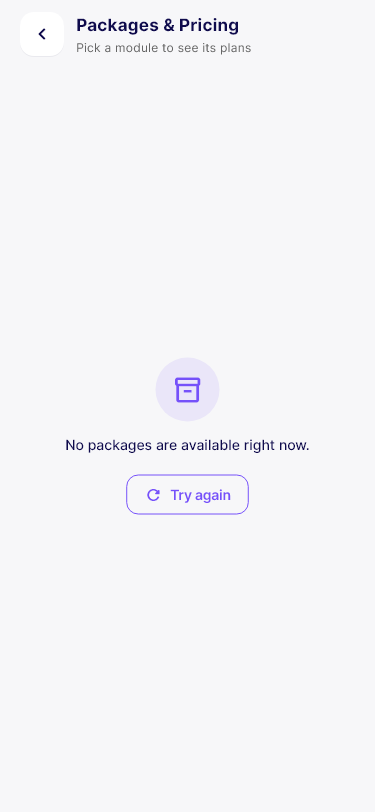
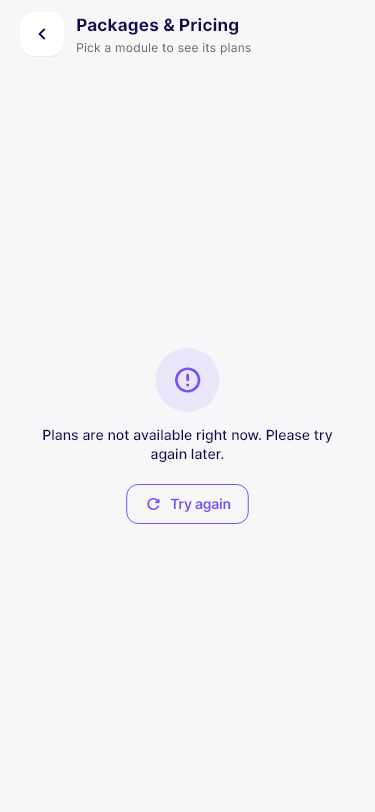

# Packages & Pricing — Backend API Requirements

> **RULE — read first.** If any API already exists for this screen, under any name or path (e.g. `/api/packages`, `/api/plans`, `/api/subscription`), **make these changes in THAT existing API. Do not create a duplicate.** Create a new API only where none exists.

**For:** backend developer (Node.js / Express) · **From:** Flutter team · **Updated:** 3 Nov 2026
**Why:** the app's Packages & Pricing screen gets a 404 because the route doesn't exist on the server — see [01_api_404_RCA.md](01_api_404_RCA.md).
**This replaces** `docs/package_pricing_api.md` and the earlier version of this file.

## Scope (what changed)

The Packages & Pricing screen is now **one dynamic list of 4 module cards**:

| Module | `moduleKey` | In the app |
|---|---|---|
| Attendance | `attendance` | **Coming soon** (not tappable) |
| Walkie-Talkie | `walkie_talkie` | **View plans** → opens the existing Walkie-Talkie plan screen |
| Safe Zone + Safe Route | `safe_zone_route` | **Coming soon** |
| Live Tracking | `live_tracking` | **Coming soon** |

The per-module pricing screen has been **removed from the app** for now. Only Walkie-Talkie has an inner screen, and it already runs on the existing `/api/walkie/*` APIs.

| # | API | Status |
|---|---|---|
| 1 | `GET /api/packages` | **New — build this** |
| — | `/api/walkie/plans`, `/coupons/*`, `/orders/summary`, `/payment/create-order`, `/payment/verify`, `/overview` | **Exists — OK, don't change** |
| — | Per-module plans, package create-order / verify / failed, entitlements, history, webhooks | **Removed — do not build now.** They come back when another module goes on sale. |

---

## General rules

1. **Response format**, the one every FG Tracker API already uses: `{ "status": true, "message": "…", "data": { } }`. Keep `status` (boolean), not `success`.
2. **Error format:** `{ "status": false, "message": "…", "code": "SOME_CODE", "errors": null }`. The app never shows `message` to users (it shows its own friendly text), so `message` can be technical.
3. **HTTP codes the app handles:** `200` · `400` · `401` (the app logs the user out) · `404` · `500`. A `200` with `status:false` is treated as an error.
4. **Auth:** `Authorization: Bearer <token>`, same middleware as `/api/walkie/*`.
5. **Everything on the cards comes from this API/DB.** The app has no hard-coded packages.
6. **404 handler:** please include the HTTP method in the message: `Can't find GET /api/packages on the server!`.

---

## The screen

Opened from Home → "Upgrade to Premium" → **View Plans**. These are renders of the app's real widgets; the values are sample input in the shape below.

| Loaded | Loading | Empty | Error |
|---|---|---|---|
|  |  |  |  |

| UI element | Field | Notes |
|---|---|---|
| Card order | `sortOrder` | ascending |
| Icon tile | `iconUrl` | optional; the app has a built-in icon per `moduleKey` |
| Icon / chevron / badge colour | `themeColor` | optional `#RRGGBB`; built-in colour otherwise |
| Title | `title` | 1 line |
| Pill next to the title ("Popular") | `badge` | optional, short |
| Subtitle | `tagline` | up to 2 lines |
| Grey chips | `highlights[]` | first 3 shown |
| Footer "View plans" / "Coming soon" | `isAvailable` + `moduleKey` | The app opens only `walkie_talkie`; the other three always show "Coming soon" for now. Still send the real `isAvailable`. `false` on Walkie-Talkie turns it to "Coming soon" too. |
| Tap | `moduleKey` | `walkie_talkie` → existing Walkie-Talkie plan screen |

Not shown on the card, so don't send them: prices, currency, plan lists, subscription status.

---

## API #1 — Package list · **New**

| | |
|---|---|
| Purpose | The 4 module cards on the Packages & Pricing screen |
| Method + path | `GET /api/packages` |
| Auth | Bearer token |
| Request | No body. Optional query `module` = `attendance` \| `walkie_talkie` \| `safe_zone_route` \| `live_tracking` (returns only that module). |
| Used by | `PackageListController.fetchPackages` → `PackageListView` / `PackageCard` |
| Status | **New** |

**200 response**
```json
{
  "status": true,
  "message": "Packages fetched",
  "data": {
    "packages": [
      {
        "id": 1,
        "moduleKey": "attendance",
        "title": "Attendance",
        "tagline": "Daily check-in, check-out and reports for your team",
        "iconUrl": null,
        "themeColor": "#16A34A",
        "badge": "Popular",
        "isAvailable": false,
        "highlights": ["Check-in / out", "Reports"],
        "sortOrder": 1
      },
      {
        "id": 2,
        "moduleKey": "walkie_talkie",
        "title": "Walkie-Talkie",
        "tagline": "Push-to-talk voice for your group",
        "iconUrl": "https://fgtracker.in/uploads/icons/walkie.png",
        "themeColor": "#704AFA",
        "badge": null,
        "isAvailable": true,
        "highlights": ["Push to talk", "Team channels"],
        "sortOrder": 2
      },
      {
        "id": 3,
        "moduleKey": "safe_zone_route",
        "title": "Safe Zone + Safe Route",
        "tagline": "Geo-fence alerts and route deviation alerts",
        "iconUrl": null,
        "themeColor": "#EA580C",
        "badge": null,
        "isAvailable": false,
        "highlights": ["Geo-fence", "Route alerts"],
        "sortOrder": 3
      },
      {
        "id": 4,
        "moduleKey": "live_tracking",
        "title": "Live Tracking",
        "tagline": "See your team on the map in real time",
        "iconUrl": null,
        "themeColor": "#2563EB",
        "badge": null,
        "isAvailable": false,
        "highlights": ["Live map", "Location history"],
        "sortOrder": 4
      }
    ]
  }
}
```

| Field | Type | Required | Notes |
|---|---|---|---|
| `id` | int | yes | DB id |
| `moduleKey` | string | **yes** | one of the four keys. Rows with an empty key are skipped; a new key renders with a default icon. |
| `title` | string | yes | |
| `tagline` | string \| null | no | |
| `iconUrl` | string \| null | no | absolute URL |
| `themeColor` | string \| null | no | `#RRGGBB` |
| `badge` | string \| null | no | |
| `isAvailable` | bool | yes | `false` = Coming soon |
| `highlights` | string[] | no | ≤3 shown |
| `sortOrder` | int | yes | |

Numbers and booleans as strings (`"2"`, `"true"`) are accepted, but real JSON types are preferred. Unknown extra fields are ignored.

**Empty:** `200` with `"packages": []` → the app shows "No packages are available right now."

**Errors**
```json
400 { "status": false, "message": "Unknown module", "code": "INVALID_MODULE", "errors": { "module": "must be one of attendance, walkie_talkie, safe_zone_route, live_tracking" } }
401 { "status": false, "message": "Please provide a token", "code": "UNAUTHORIZED" }
500 { "status": false, "message": "Internal server error", "code": "SERVER_ERROR" }
```

**Suggested table `packages`:** `id`, `module_key` (unique), `title`, `tagline`, `icon_url`, `theme_color`, `badge`, `is_available`, `highlights` (JSON), `sort_order`, `created_at`, `updated_at`. Seed the four rows above.

---

## Checklist for the backend developer
- [ ] Confirm no existing route already serves this (see the rule at the top).
- [ ] Add `GET /api/packages` behind the existing auth middleware, registered **before** the catch-all 404 handler.
- [ ] Seed the 4 modules (Walkie-Talkie `isAvailable: true`, the other three `false`).
- [ ] Deploy and restart the server.
- [ ] Check: `curl -H "Authorization: Bearer <token>" http://fgtracker.in:3000/api/packages` → `200` with 4 packages. Without a token → `401`, not `404`.
- [ ] Optional: add the HTTP method to the 404 handler message.
