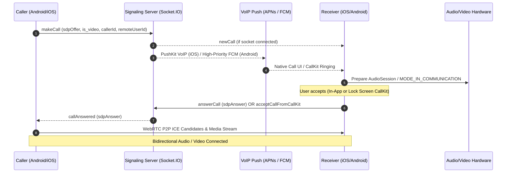

# Cross-Platform Audio & Video Calling Reference Guide & Testing Matrix

This document provides architectural documentation, reliability implementations, and a comprehensive manual testing checklist for cross-platform calling across **Android ↔ iOS**, **iOS ↔ Android**, and **iOS ↔ iOS**.

---

## 1. Architectural Call Flow & Reliability Core

### 1.1 Cross-Platform Signaling Architecture

### 1.2 Key Reliability Fixes Implemented

1. **iOS CallKit Incoming Acceptance (`call_kit_handlers.dart` & `callkit_service.dart`)**:
   - **Enriched Argument Resolution**: Normalized caller identifiers (`callerId`, `caller_id`, `remoteUserId`, `user_id`, `userId`), caller names (`callerName`, `caller_name`), avatar images, video flags, and SDP offer payloads (`sdpOfferCompressed`, `sdpOffer`, `offer`).
   - **Payload Preservation**: Resolved `_handleAccept` in `callkit_service.dart` to pass the complete enriched `payload` (containing `callId`, `sessionId`, `uuid`) to `onAcceptCall`, eliminating missing caller IDs on background / lock screen accepts.
   - **Navigation Conflict Avoidance**: Used `Get.offNamed` when already on `Routes.callScreen` to prevent duplicate controller bindings or navigation stack corruption.

2. **Audio Routing & Hardware Synchronization (`call_audio_route_controller.dart`)**:
   - **iOS AudioSession Activation**: Removed blocking platform guards so iOS `AudioSession` configures `playAndRecord` with `voiceChat` (audio) or `videoChat` (video) modes and AirPlay/Bluetooth options.
   - **Android Infinite Loop Elimination**: Fixed `_routeSatisfied` on Android so `earpiece` correctly verifies `!legacySpeaker` when `actual == null`, stopping audio stutter and 3-second resets.
   - **Dynamic Device Switching**: Added auto-routing to Bluetooth headphones/AirPods and wired headsets upon connect/disconnect.
   - **Clean Teardown**: Ensured `Helper.setSpeakerphoneOn(false)` and proximity lock release execute on both iOS and Android before deactivating audio sessions.

3. **Track Synchronization & Video Smoothness (`calling_controller.dart`)**:
   - **Mic Mute Sync**: `toggleMic()` and `setMutedFromSystem()` synchronously update RTCRtpSenders on the active peer connection alongside local stream tracks.
   - **Camera Flip Keyframe**: Instant remote rendering on camera flip via `_forceKeyframe()`.
   - **H.264 SDP Preference**: Unified video payload format negotiation between Android MediaCodec and iOS VideoToolbox.

4. **Unified Calling Screen UI**:
   - Styled outgoing/connecting and connected screens to the deep indigo/purple design system (`[#6B4FE8, #4B32B8, #2E1F7A]`), eliminating widget tree tearing and crashes upon call answer.

---

## 2. Comprehensive Manual Testing Matrix

| Test Suite | Scenario | Initial State | Action | Expected Result | Pass/Fail |
| :--- | :--- | :--- | :--- | :--- | :--- |
| **A. iOS ↔ iOS Call Receiving** | A1. Foreground Audio Call | App foreground on both devices | User A calls User B | User B displays in-app incoming screen; tapping Accept connects audio immediately. | [ ] |
| | A2. Background Audio Call | App in background on User B | User A calls User B | Native CallKit rings on User B; answering brings app to foreground and joins call cleanly. | [ ] |
| | A3. Lock Screen Audio Call | User B screen locked | User A calls User B | Native CallKit lock screen UI rings; slide to answer connects audio; unlocking opens active call screen. | [ ] |
| | A4. Foreground Video Call | Both apps open | User A video calls User B | User B accepts; camera previews initialize, two-way video renders without black screen. | [ ] |
| | A5. Lock Screen Video Call | User B screen locked | User A video calls User B | CallKit rings indicating video call; answering prompts unlock and immediately displays video streams. | [ ] |
| **B. Android ↔ iOS Calling** | B1. Android to iOS Audio | Android calls iOS | User A (Android) audio calls User B (iOS) | iOS receives CallKit ring; accepting connects audio with earpiece active on both devices. | [ ] |
| | B2. iOS to Android Audio | iOS calls Android | User A (iOS) audio calls User B (Android) | Android full-screen incoming UI rings; accepting connects two-way audio. | [ ] |
| | B3. Android to iOS Video | Android calls iOS | User A (Android) video calls User B (iOS) | Video negotiates H.264 profile; both local preview and remote video render smoothly. | [ ] |
| | B4. iOS to Android Video | iOS calls Android | User A (iOS) video calls User B (Android) | Two-way video renders smoothly; aspect ratios adapt without stretching. | [ ] |
| **C. Audio Routing & Bluetooth** | C1. Earpiece to Speaker | Active audio call | Tap Speaker button | Audio immediately transitions to bottom loud speaker; button highlights. | [ ] |
| | C2. Speaker to Earpiece | Active audio call on speaker | Tap Earpiece button | Audio returns to earpiece immediately; proximity sensor activates (screen turns off when near ear). | [ ] |
| | C3. Bluetooth Connect | Active call on earpiece/speaker | Connect AirPods / Bluetooth headset | Audio routes to Bluetooth device automatically within 1-2 seconds. | [ ] |
| | C4. Bluetooth Disconnect | Active call on Bluetooth | Disconnect Bluetooth headset | Audio gracefully falls back to earpiece (or speaker if video call) without freezing. | [ ] |
| | C5. Wired Headset | Active call | Plug in 3.5mm / Lightning / USB-C earphones | Audio switches to wired headphones immediately; unplugging reverts to default route. | [ ] |
| **D. Mute, Camera & Controls** | D1. Local Mic Mute | Active call | Tap Mute button | Mic track disables; remote hears silence; UI reflects mute state. | [ ] |
| | D2. Local Mic Unmute | Active call muted | Tap Unmute button | Mic track re-enables; remote hears audio; UI reflects active state. | [ ] |
| | D3. Lock Screen / System Mute | CallKit active on iOS | Tap mute on iOS native CallKit or headphones | In-app controller updates `isMuted` and synchronizes tracks. | [ ] |
| | D4. Camera Flip (Front/Back) | Active video call | Tap Camera Switch button | Video flips smoothly; remote receives keyframe immediately without frozen frames. | [ ] |
| | D5. Camera On/Off Toggle | Active video call | Tap Camera Off button | Video track pauses; remote displays user avatar; toggling On resumes video feed. | [ ] |
| **E. Call Teardown & Edge Cases** | E1. Normal End (Caller) | Active call | Caller taps Red End Call button | Call finishes; audio session deactivates; both devices return to prior screen cleanly. | [ ] |
| E2. Normal End (Receiver) | Active call | Receiver taps End Call button | Socket sends `callEnded`; caller teardown completes; timers cancel. | [ ] |
| E3. Decline Call (Foreground) | Ringing call | Receiver taps Decline | Ringing stops; caller receives `callRejected` and displays "Call declined". | [ ] |
| E4. Decline Call (Lock Screen) | Locked iOS receiving call | Receiver presses Side button / Decline | CallKit dismisses; server notified via REST or socket fallback. | [ ] |
| E5. Ring Timeout (No Answer) | Ringing call | No answer for 45 seconds | Call times out automatically; caller displays "No answer"; missed call push recorded. | [ ] |
| E6. Network Interruption | Active call | Turn on Airplane mode on one device | Connection monitor detects drop; displays reconnecting status; cleans up if unreachable. | [ ] |

---

## 3. Automated Unit Testing Coverage

Automated tests verified under `test/call_qa/`:
- `test/call_qa/call_audio_and_state_reliability_test.dart`:
  - Initial voice vs video call default routes.
  - Route enum conversions and reactive stream properties.
  - Normalization of caller IDs and parameters in `incomingCallArgs`.
  - Rejection payload routing.
  - Lock screen system action mapping (`CallKitSystemAction`).
- `test/call_qa/call_backend_contract_v1_test.dart`:
  - Signaling token handshake options.
  - REST decline API URL format and headers.
